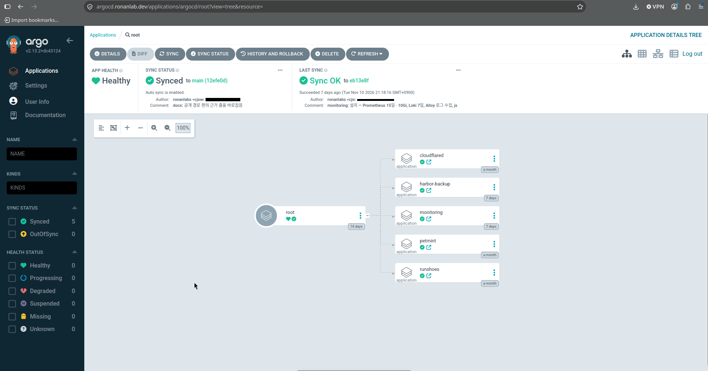

<!--
다루는 곳: README.md, cluster/Vagrantfile, cluster/label-nodes.sh, bootstrap/root-app.yaml, apps/cloudflared/, apps/monitoring/README.md, apps/petmint/app/, apps/runshoes/README.md
읽은 커밋: ddbaadf
-->
# 한눈에 보는 홈랩

> 이 글은 홈랩 전체에서 무엇을 만들었는지와, 뒤의 편들이 다루는 결정들을 한자리에 모아 보여 줍니다.

**GPU가 든 서버 한 대 안에 가상 머신 다섯 대로 쿠버네티스 클러스터를 직접 세우고, 그 위에서 실제로 공개된 서비스 둘과 배포, 이미지 저장, 모니터링 도구를 운영합니다. 바깥 요청은 Cloudflare 터널로 들어오고, 언어 모델 추론은 클러스터 밖 호스트의 GPU가 맡습니다.**

## 무엇을 만들었나

홈랩은 집이나 사무실에 직접 차려 두고 이것저것 시험해 보는 서버 환경을 말합니다. 모든 것은 물리 서버 한 대 위에 있습니다. 이 서버에는 NVIDIA GeForce RTX 5070 Ti 그래픽카드 한 장이 꽂혀 있습니다 [docs:history/notion_hardware_20261116.md:16] [docs:history/cluster_state_20261116.md:76]. 쿠버네티스(여러 컴퓨터를 한 덩어리로 묶어 프로그램을 알아서 나눠 띄우고, 죽으면 다시 띄워 주는 관리 시스템)는 이 서버 안의 가상 머신(VM, 소프트웨어로 흉내 낸 컴퓨터) 다섯 대 위에 세웠습니다 [code:cluster/Vagrantfile:3-10] [code:README.md:3].

다섯 대 가운데 m-k8s 한 대는 클러스터 전체를 지휘하는 control-plane이고, 나머지 w1부터 w4까지 네 대는 실제 프로그램을 돌리는 워커입니다 [docs:history/cluster_state_20261116.md:9-15]. 워커는 맡은 일이 정해져 있습니다. w1과 w2는 서비스 앱과 데이터베이스를, w3는 배포와 빌드 도구를, w4는 모니터링을 맡습니다. 그래서 w3가 멈추면 새 배포와 빌드가 멈춰도 돌던 서비스는 그대로이고, w4가 멈추면 모니터링이 멈춥니다 [code:cluster/label-nodes.sh:6-8].

클러스터가 바깥에 내놓는 서비스는 둘입니다. petmint(펫퍼민트)는 반려동물 보험 상담을 해 주는 RAG 챗봇이고, runshoes(런슈즈)는 러닝화 스펙을 모아 보여 주는 아카이브 사이트입니다 [docs:history/build_log/07_project_deploy.md:16] [code:apps/runshoes/README.md:3]. RAG는 질문이 오면 먼저 약관 같은 자료에서 관련 대목을 찾아 붙인 뒤 언어 모델에 답을 짓게 하는 방식입니다. 두 앱 모두 앱 파드(쿠버네티스가 띄우는 가장 작은 실행 단위) 두 개를 서로 다른 노드에 나눠 띄워, 노드 하나가 죽어도 다른 파드가 요청을 받습니다 [code:apps/petmint/app/deployment.yaml:1-3] [code:apps/runshoes/app/deployment.yaml:8-10].

서비스를 만들고 지키는 운영 도구도 같은 클러스터에서 돕니다. ArgoCD는 저장소에 적힌 대로 클러스터를 맞추는 배포 도구, Harbor는 앱 이미지(프로그램과 실행 환경을 통째로 묶은 꾸러미)를 보관하는 사설 저장소, Jenkins는 앱 코드를 받아 이미지를 만드는 빌드 도구입니다 [code:cluster/label-nodes.sh:7]. 모니터링은 Prometheus(지표), Loki(로그), Grafana(대시보드)로 이루어져 있습니다 [code:apps/monitoring/README.md:3-6].

이 저장소의 main 브랜치에 적힌 것이 곧 클러스터의 모습입니다. ArgoCD에는 맨 위의 루트 앱 하나만 사람이 넣고, 루트가 저장소의 앱 폴더마다 있는 정의 파일을 읽어 앱별 배포 단위를 만듭니다 [code:bootstrap/root-app.yaml:1-6]. 앱 코드가 바뀌면 Jenkins가 이미지를 만들어 Harbor에 올리고, 이 저장소의 이미지 태그를 바꿔 커밋하며, ArgoCD가 그 커밋을 보고 앱을 새 이미지로 바꿔 끼웁니다 [docs:history/build_log/07_project_deploy.md:3] [code:apps/petmint/app.yaml:1-4].

## 요청 하나가 닿는 길

사용자가 브라우저에서 ronanlab.dev 아래의 서비스 주소를 열면, 요청은 먼저 Cloudflare에 닿습니다. 클러스터 안의 cloudflared 파드 두 개가 Cloudflare 쪽으로 미리 연결을 열어 두었기 때문에, 요청은 그 연결을 거꾸로 타고 서버 안으로 들어옵니다 [code:apps/cloudflared/README.md:3-4] [code:apps/cloudflared/deployment.yaml:13]. 공유기에 웹 서비스용 포트포워딩을 열지 않아도 되는 까닭이 이것입니다 [docs:history/human_answers_20261117.md:13]. cloudflared는 받은 요청을 모두 클러스터의 들어오는 문인 ingress-nginx로 넘기고, ingress-nginx가 주소를 보고 알맞은 앱의 파드로 나눠 줍니다 [docs:history/cluster_state_20261116.md:38-50]. 펫퍼민트처럼 언어 모델이 필요한 앱은 마지막으로 VM 바깥의 호스트에서 도는 추론 서버 Ollama, 임베딩 서비스, 벡터 검색 Milvus를 사설 고정망 쪽 호스트 주소로 부릅니다 [docs:history/cluster_state_20261116.md:77-80]. GPU를 쓰는 일은 클러스터가 아니라 호스트가 맡습니다.

## 결정 모음

뒤의 편은 이 길을 따라 갈림길 하나씩을 다룹니다.

| 갈림길 | 고른 것 | 편 |
| --- | --- | --- |
| 클러스터를 어떻게 세우나 | kubeadm으로 노드 여러 대를 직접 | → 「손으로 세운 여러 노드 클러스터」 |
| 노드끼리 어느 망으로 말하나 | 관리망과 따로 붙인 고정망 | → 「랜카드 둘: 관리망과 고정망」 |
| 바깥 요청을 어디서 받나 | 대표 주소 하나와 들어오는 문 하나 | → 「문은 하나만: MetalLB와 ingress-nginx」 |
| 서비스를 어떻게 공개하나 | Cloudflare 터널 | → 「포트포워딩 없이 공개하기」 |
| 암호화를 어디서 푸나 | 공개 앱은 Cloudflare, 운영 도구는 들어오는 문에서 | → 「TLS가 끝나는 곳과 noTLSVerify를 확인한 일」 |
| GPU를 어디에 두나 | 호스트에 두고 파드는 불러 쓰기만 | → 「GPU는 호스트에, 파드는 불러 쓰기만」 |
| 배포를 누가 하나 | Jenkins와 ArgoCD | → 「사람 손을 타지 않는 배포」 |
| 모니터링을 어떻게 넣나 | 차트 대신 직접 쓴 매니페스트 | → 「모니터링은 차트 대신 매니페스트로」 |
| 노드가 모자라면 | 워커를 더하고 도구를 옮김 | → 「워커를 늘리고 옮기기」 |
| 문서가 틀리지 않게 | 점검 스크립트 | → 「문서를 기계로 검사하기」 |
| 하지 않은 것 | 한계를 그대로 적음 | → 「하지 않은 것과 한계」 |

## 치른 값

- 모든 것이 물리 서버 한 대 안에 있습니다. 서버가 꺼지면 클러스터, 운영 도구, 추론 서버가 함께 멈춥니다 [code:README.md:3] [docs:history/build_log/01_cluster.md:699].
- 바깥 공개 주소는 모두 터널 하나를 지납니다. 터널이 깨지면 서비스와 함께 ArgoCD, Grafana 같은 고칠 도구의 화면도 바깥에서 보이지 않습니다 [code:apps/cloudflared/app.yaml:4-7].
