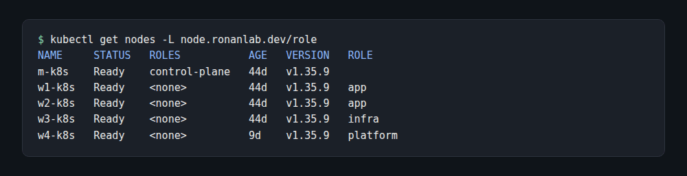
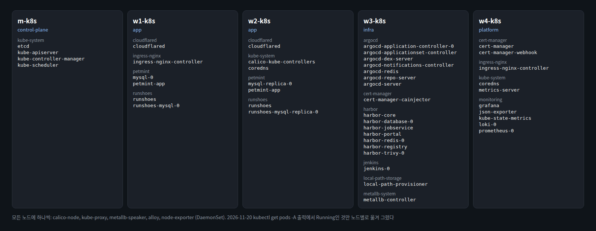

<!--
다루는 곳: cluster/Vagrantfile, cluster/label-nodes.sh, platform/versions.yaml, apps/petmint/app/deployment.yaml, apps/runshoes/app/deployment.yaml
읽은 커밋: ddbaadf
-->
# 손으로 세운 여러 노드 클러스터

> 이 글은 서버가 한 대뿐인데도 클러스터를 노드 다섯 대로 나누고, 설치 도구 kubeadm으로 직접 세운 결정을 다룹니다.

**수업에서 쓴 단일 노드 클러스터 대신, 지휘하는 노드와 일하는 노드를 나눈 여러 노드 클러스터를 kubeadm으로 손수 세웠습니다. 실제 운영 클러스터가 그렇게 생겼고, 파드가 여러 노드에 흩어지고 한 노드가 죽으면 다른 노드가 넘겨받는 모습은 노드가 여럿이어야 보여 줄 수 있기 때문입니다.**

## 상황

학교 수업에서 쓴 쿠버네티스는 k3s와 학교 vcluster였고, 둘 다 지휘하는 역할(control-plane)과 일하는 역할(워커)이 한 몸인 단일 노드였습니다 [docs:history/build_log/01_cluster.md:126]. 단일 노드는 배우기에는 편하지만, 쿠버네티스가 원래 하려는 일, 곧 여러 컴퓨터에 프로그램을 나눠 띄우고 한 대가 죽으면 다른 대로 옮기는 일은 보여 주지 못합니다.

손에 있는 것은 GPU가 든 물리 서버 한 대였습니다. 이 서버는 32코어에 메모리 61GiB로, 클러스터 말고도 언어 모델 추론과 학습을 함께 돌려야 했습니다 [docs:history/cluster_state_20261116.md:75] [docs:history/build_log/01_cluster.md:27].

## 고른 것

서버 한 대 안에 가상 머신 다섯 대를 만들고, 이 다섯 대를 kubeadm으로 묶었습니다. kubeadm은 쿠버네티스가 공식으로 내놓은 설치 도구로, control-plane을 세우는 일과 다른 노드를 붙이는 일을 맡습니다. 지금 클러스터는 v1.35.9이고, 다섯 대가 모두 같은 판입니다 [code:platform/versions.yaml:8-10] [docs:history/cluster_state_20261116.md:9-15]. VM은 Vagrant라는 도구가 정의 파일 하나를 보고 만들고, 다섯 대 모두 CPU 둘씩에 control-plane은 메모리 4GB, 워커는 8GB씩을 받습니다 [code:cluster/Vagrantfile:3-10].

```
m-k8s   control-plane   역할 라벨 없음
w1-k8s  워커            app       (서비스 앱과 데이터베이스)
w2-k8s  워커            app       (서비스 앱과 데이터베이스)
w3-k8s  워커            infra     (배포와 빌드 도구)
w4-k8s  워커            platform  (모니터링)
```

노드 이름과 역할 라벨은 실제 클러스터에서 확인한 값입니다 [docs:history/cluster_state_20261116.md:9-15]. 역할 라벨(노드에 붙여 두는 꼬리표)에 따라 무엇이 어디에 뜨는지가 정해집니다 [code:cluster/label-nodes.sh:6-8].





## 까닭

까닭은 셋으로 기록되어 있습니다. 첫째, 실제 운영 클러스터는 control-plane과 워커가 나뉘어 있고, 일꾼 노드 하나가 죽어도 다른 노드가 파드를 대신 받도록 짜여 있습니다. 둘째, control-plane 하나와 워커 여러 대로 된 클러스터를 kubeadm으로 직접 세우는 일이 쿠버네티스 관리자 자격 시험(CKA)의 범위 자체입니다 [docs:history/build_log/01_cluster.md:136-137] [docs:history/build_log/kubernetes_install.md:124]. 셋째, 워커가 한 대뿐이면 분산을 보여 줄 수 없습니다. 파드가 여러 노드에 흩어지고, 한 노드가 멈췄을 때 다른 노드가 받는 모습은 워커가 적어도 두세 대는 있어야 실제로 일어납니다 [docs:history/build_log/01_cluster.md:138].

이 까닭은 설정에도 그대로 남아 있습니다. 두 서비스 앱은 파드를 두 개씩 띄우되 같은 노드에 둘을 두지 못하게 규칙을 걸어 w1과 w2에 하나씩 나눕니다. 노드 하나가 죽어도 다른 노드의 파드가 요청을 받습니다 [code:apps/petmint/app/deployment.yaml:1-4] [code:apps/runshoes/app/deployment.yaml:8-10]. 워커마다 역할을 정해 둔 것도 같은 생각에서 나왔습니다. 한 노드가 죽었을 때 무엇이 멈추는지를 미리 정해 두어, 배포 도구가 있는 w3가 멈추면 새 배포와 빌드가, 모니터링이 있는 w4가 멈추면 모니터링이 멈춥니다 [code:cluster/label-nodes.sh:7-8]. 실제로 노드를 비워 가며 도구를 옮긴 일과, 그때 무엇이 끊기지 않았고 무엇이 잠깐 끊겼는지는 → 「워커를 늘리고 옮기기」에 있습니다 [docs:history/human_answers_20261117.md:15].

## 치른 값

- control-plane은 m-k8s 한 대입니다. m-k8s가 멈추면 이미 뜬 파드는 계속 돌지만, 새 배치와 복구, 사람의 명령이 멈춥니다 [docs:history/build_log/01_cluster.md:700]. 늘리려면 클러스터 상태를 저장하는 etcd가 과반으로 결정하는 방식이라 셋이 필요합니다. 그런데 VM이 모두 같은 물리 서버 한 대 위에 있어, 셋으로 늘려도 서버가 꺼지면 함께 꺼집니다. 들이는 자원만큼 얻는 것이 없습니다 [c:a40b111].
- 노드마다 VM을 따로 두는 만큼 서버 자원을 VM 몫으로 미리 떼어 둡니다. 다섯 대 몫을 떼고 남은 호스트 메모리를 언어 모델과 학습 작업이 나눠 씁니다 [code:cluster/Vagrantfile:3-10] [docs:history/build_log/01_cluster.md:27].
- 손으로 세운 만큼 설치한 판이 저장소에 저절로 남지 않습니다. kubeadm, 컨테이너 런타임, 파드 망 도구 Calico처럼 저장소에 매니페스트가 없는 것의 판은 원래 클러스터 안에만 있어서, 클러스터가 사라지면 같은 환경을 다시 만들 수 없습니다. 그래서 그 판을 `platform/versions.yaml`에 옮겨 적었습니다. 이 파일은 어떤 설치기도 읽지 않는 기록이라, 판을 올릴 때 사람이 같은 변경에서 함께 고쳐야 합니다 [docs:history/human_answers_20261116.md:19] [code:platform/versions.yaml:1-6] [code:platform/versions.yaml:14-18].

## 조건

아래는 고른 것이 아니라 바탕이 그러해서 따라오는 것입니다.

- 노드를 여럿으로 나눠도 물리 서버가 한 대인 것은 여러 결정에 걸려 → 「알려진 한계」에 모았습니다
