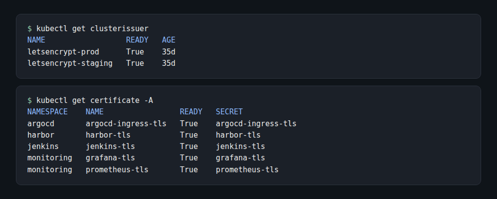

<!--
다루는 곳: apps/cloudflared/configmap.yaml, platform/cert-manager/, platform/harbor/values.yaml, platform/argocd/ingress.yaml
읽은 커밋: ddbaadf
-->
# TLS가 끝나는 곳과 noTLSVerify를 확인한 일

> 이 글은 브라우저의 암호화가 어디서 풀리는지를 공개 앱과 운영 도구로 나눈 결정과, 터널 구간의 인증서 확인을 끈 까닭을 문서에 잘못 적었다가 클러스터에서 확인해 바로잡은 일을 다룹니다.

**공개 앱은 Cloudflare에서, 운영 도구는 클러스터의 ingress-nginx에서 TLS를 끝냅니다. 터널 구간에서 인증서 확인을 끈 까닭은 처음에 옛 기록을 그대로 옮겨 적었다가, 그 기록이 다섯 주소를 설명하지 못한다는 것을 찾아 읽기 명령으로 확인하고 고쳤습니다.**

## 상황

TLS는 브라우저와 서버 사이의 내용을 암호화하고, 상대가 그 주소의 진짜 주인인지 인증서로 확인하는 규약입니다. 주소창의 자물쇠가 이것입니다. 요청은 브라우저에서 Cloudflare, 터널, 클러스터 안의 문(ingress-nginx)을 거쳐 앱에 닿는데, 이 가운데 어디서 암호화를 풀지, 곧 TLS를 어디서 끝낼지 정해야 했습니다. 길 자체는 → 「포트포워딩 없이 공개하기」에서 다룹니다.

## 고른 것

공개 앱 둘(petmint, runshoes)은 Cloudflare 엣지(Cloudflare가 곳곳에 둔 서버로, 공개 주소로 온 요청을 처음 받는 곳)에서 TLS를 끝냅니다. 두 앱의 Ingress(요청을 어느 서비스로 보낼지 적은 규칙)에는 인증서 칸이 없고, 브라우저가 보는 자물쇠는 Cloudflare의 것입니다 [docs:history/cluster_state_20261116.md:45-46] [docs:history/build_log/07_project_deploy.md:457].

운영 도구 다섯(ArgoCD, Harbor, Jenkins, Grafana, Prometheus)은 ingress-nginx에서 TLS를 끝냅니다. 인증서는 cert-manager(클러스터 안에서 인증서를 받아 오는 프로그램)가 공인 인증 기관 Let's Encrypt에서 받아 오고, 다섯 개 모두 발급을 마친 상태입니다 [docs:history/cluster_state_20261116.md:38-48].



Let's Encrypt가 이름의 주인인지 시험하는 방식은 DNS-01(그 이름의 DNS에 정해진 기록을 올려 증명하는 방식)을 씁니다. 바깥에서 서버의 파일을 열어 보게 하는 방식은 쓸 수 없습니다. 들어오는 포트를 열지 않았고 운영 도구는 로그인 관문 뒤에 있기 때문입니다 [code:platform/cert-manager/values.yaml:1].

## 까닭

운영 도구에만 우리 인증서를 둔 까닭은 그 이름을 클러스터 안에서도 부르기 때문입니다 [docs:history/build_log/07_project_deploy.md:457]. 대표적인 것이 노드가 Harbor에서 이미지를 받을 때입니다. 노드는 공개 주소와 같은 이름으로 사설망 고정 주소(VIP)를 거쳐 Harbor에 닿고, 이때 인증서 확인을 켠 채로 받습니다. 공인 기관의 인증서라 노드마다 우리만의 인증 기관을 심어 둘 필요도 없습니다 [code:platform/harbor/values.yaml:3-4] [docs:history/build_log/02_metrics_storage_ingress.md:209]. 이 길은 Cloudflare를 거치지 않으니 Cloudflare의 인증서로는 대신할 수 없습니다.

기록에 남은 까닭은 운영 도구 쪽의 이것뿐입니다. 공개 앱에 인증서를 두지 않은 까닭은 따로 적혀 있지 않고, 기록은 공개 앱의 TLS가 Cloudflare 엣지에서 끝난다는 사실만 적고 있습니다 [docs:history/build_log/07_project_deploy.md:457].

## 치른 값

- 터널에서 ingress-nginx까지 가는 구간에서 cloudflared는 상대의 인증서를 확인하지 않습니다(noTLSVerify). 일곱 주소 모두 그렇습니다. 이 구간에서는 상대가 진짜 ingress-nginx인지 따지지 않습니다 [code:apps/cloudflared/configmap.yaml:13-43]
- 모든 Ingress가 HTTP로 온 요청을 HTTPS로 돌려보내지 않게 꺼 두었습니다. 사설망 안에서는 암호화하지 않은 HTTP로도 같은 화면에 닿습니다 [code:platform/argocd/ingress.yaml:7] [code:platform/argocd/ingress.yaml:15]
- 인증서 발급에 쓰는 Cloudflare API 토큰이 저장소에 없는 것은 비밀값을 저장소에 두지 않는 결정에서 나와 → 「알려진 한계」에 모았습니다

## 막혔을 때: 확인을 끈 까닭을 다시 확인한 일

첫 번째 치른 값, 곧 cloudflared가 인증서 확인을 끈 까닭을 기술문서에 처음 적을 때는 구축 기록을 그대로 옮겼습니다. 구축 기록의 설명은 이렇습니다. ingress-nginx의 기본 인증서는 스스로 서명한 것이라 확인이 실패하고, 그 구간은 클러스터 안 통신이며 터널이 이미 암호화하므로 확인을 끈다는 것입니다 [docs:history/build_log/03_cloudflare_tunnel.md:160]. 원점을 HTTPS로 적은 까닭도 같은 기록에서 가져왔는데, HTTP로 적으면 문이 HTTPS로 다시 오라고 돌려보내 터널을 맴돌 수 있다는 것이었습니다 [docs:history/build_log/03_cloudflare_tunnel.md:159].

문서를 다시 읽으며 이 설명이 지금 클러스터와 범위가 맞지 않는다는 것을 찾았습니다. 그 기록은 인증서가 없는 앱 주소를 두고 쓴 것입니다. 운영 도구 다섯 주소에는 공인 인증서가 있으니 「스스로 서명한 인증서라 실패한다」는 설명이 맞지 않습니다. 돌려보내기 이야기도 학교 클러스터에서 다른 문 프로그램(traefik)을 쓰던 때의 것이고, 지금 Ingress 일곱 개는 돌려보내기를 꺼 두었습니다 [c:3ac6eb1] [docs:history/build_log/03_cloudflare_tunnel.md:157] [code:platform/argocd/ingress.yaml:15] [code:platform/harbor/values.yaml:16] [code:platform/jenkins/values.yaml:10] [code:apps/monitoring/ingress.yaml:39] [code:apps/monitoring/ingress.yaml:66] [code:apps/petmint/app/ingress.yaml:12] [code:apps/runshoes/app/ingress.yaml:11]. 먼저 문서를 「두 앱 주소의 까닭만 기록에 있고, 다섯 주소의 까닭은 기록에 없다」로 좁혔습니다 [c:3ac6eb1].

그다음 정말로 일곱 주소 모두에 확인을 꺼야 하는지 클러스터에서 확인했습니다. 쓴 것은 읽기 명령뿐입니다. 관리 노드에서 ingress-nginx에 TLS로 붙으며 SNI(접속할 때 「이 이름으로 왔다」고 먼저 알리는 값)를 바꿔 보내고, 돌아오는 인증서의 이름과 발급자만 읽었습니다 [docs:history/notls_check_20261117.md:3] [docs:history/notls_check_20261117.md:7].

```
보낸 이름                      받은 인증서
터널 설정의 원점(서비스 이름)  → 자체 서명 임시 인증서
argocd.ronanlab.dev            → argocd.ronanlab.dev, Let's Encrypt
grafana.ronanlab.dev           → grafana.ronanlab.dev, Let's Encrypt
petmint.ronanlab.dev           → 자체 서명 임시 인증서
```

[docs:history/notls_check_20261117.md:9-14]

여기에 Cloudflare 문서의 기본값을 맞춰 봤습니다. 따로 정하지 않으면 cloudflared는 원점 인증서에 터널 설정이 원점으로 적은 호스트 이름이 들어 있기를 기대합니다. 이 저장소의 터널 설정은 그 기본값을 바꾸지 않고, 일곱 주소 모두 원점을 클러스터 안의 ingress-nginx 서비스 이름으로 적었습니다 [docs:history/notls_check_20261117.md:18] [code:apps/cloudflared/configmap.yaml:13-17].

결론은 이렇습니다. cloudflared는 인증서에 서비스 이름이 있기를 기대하는데, ingress-nginx가 내놓는 인증서는 자체 서명 임시 인증서이거나 공개 주소 이름의 Let's Encrypt 인증서라 어느 쪽에도 그 이름이 없습니다. 그래서 확인을 켜면 운영 도구까지 일곱 주소 모두 실패합니다 [docs:history/notls_check_20261117.md:22]. 한 가지는 보지 못했습니다. cloudflared가 실제로 보내는 SNI 값은 네트워크 위에서 잡아 보지 않았습니다. 다만 결론은 SNI가 무엇이든 같습니다. 서비스 이름을 보내면 자체 서명 인증서를 받고, 공개 주소를 보내면 이름이 다른 인증서를 받기 때문입니다 [docs:history/notls_check_20261117.md:24].

확인한 내용은 기록으로 남기고, 기술문서는 「일곱 주소 모두에 필요하다」로 고쳤습니다 [c:6290346] [c:5c88dd0]. 같은 실수를 막으려고 문서 쓰는 법에 규칙도 하나 더했습니다. 옛 기록을 근거로 걸 때는 그 기록이 쓰인 때와 지금이 같은 범위인지 먼저 보고, 인증서 유무처럼 그 사이 바뀐 것이 있으면 범위를 좁혀 쓰거나 「까닭은 기록에 없다」고 적는다는 것입니다 [docs:style_guide.md:71]. 문서 검사 이야기는 → 「문서를 기계로 검사하기」에서 이어집니다.
