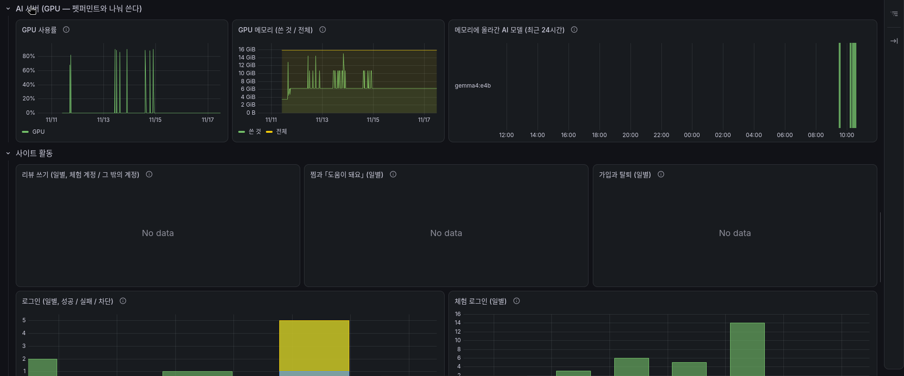

<!--
다루는 곳: scripts/host-gpu-exporter.sh, apps/petmint/app/configmap.yaml, apps/runshoes/app/deployment.yaml, apps/monitoring/json-exporter/json-exporter.yaml, CLAUDE.md
읽은 커밋: ddbaadf
-->
# GPU는 호스트에, 파드는 불러 쓰기만

> 이 글은 GPU 한 장을 쿠버네티스 가상 머신에 넘기지 않고 물리 서버에 그대로 둔 결정을 다룹니다.

**GPU와 그 GPU를 쓰는 추론 서버는 물리 서버(호스트)에 그대로 두었고, 클러스터 안의 파드는 그것을 네트워크 너머의 API로 부르기만 합니다. 가장 큰 까닭은 처음 해 보는 GPU 패스스루가 위험했고, 호스트에서 이미 쓰던 추론 서버를 멈출 수 없었다는 것입니다.**

## 상황

이 홈랩의 쿠버네티스 노드는 물리 서버 한 대 위에 올린 가상 머신(VM) 다섯 대입니다. [docs:history/cluster_state_20261116.md:9-17] 물리 서버에는 NVIDIA GeForce RTX 5070 Ti 한 장이 꽂혀 있습니다. [docs:history/cluster_state_20261116.md:76] 클러스터에서 도는 두 서비스, 문서를 찾아 답하는 챗봇인 펫퍼민트와 러닝화 스펙 아카이브인 런슈즈는 모두 언어 모델을 씁니다. [code:apps/petmint/README.md:3] [code:apps/runshoes/README.md:3] 펫퍼민트는 답을 만들 때, 런슈즈는 리뷰를 요약하고 챗봇이 답할 때 모델을 부릅니다. [code:apps/petmint/app/configmap.yaml:23-30] [code:apps/runshoes/app/deployment.yaml:98-99] [code:apps/runshoes/app/deployment.yaml:144-149]

GPU를 클러스터에서 쓰는 흔한 방법은 GPU 패스스루(물리 GPU를 VM 하나에 통째로 넘겨, 그 VM 안에서 제 장치처럼 쓰게 하는 것)입니다. 그렇게 하면 쿠버네티스가 GPU를 자원으로 알고 파드에 직접 나눠 줄 수 있습니다. 한편 호스트에서는 클러스터를 세우기 전부터 Ollama(언어 모델을 받아 두었다가 요청이 오면 GPU에 올려 답을 만드는 추론 서버)를 쓰고 있었습니다. [docs:history/build_log/kubernetes_install.md:117]

## 고른 것

GPU 패스스루를 하지 않았습니다. GPU는 호스트에 그대로 두고, GPU를 쓰는 프로그램도 호스트에서 돌립니다. 추론 서버 Ollama, 임베딩(글을 숫자 묶음으로 바꾸는 일)과 리랭킹을 맡는 model-service, 벡터 DB(뜻이 가까운 글을 찾아 주는 DB)인 Milvus, 펫퍼민트의 검색 서비스가 모두 호스트에서 돕니다. [docs:history/cluster_state_20261116.md:77-78]

파드는 이것들을 호스트 주소 하나로 부릅니다. 파드 안에서 「자기 자신」을 뜻하는 주소는 파드 자신이라, 호스트를 부르려면 VM 사설망 쪽에서 본 호스트 주소를 써야 합니다. 이 사설망은 VM 설정에 고정 주소로 박혀 있어 VM을 다시 만들어도 바뀌지 않습니다. [code:apps/petmint/app/configmap.yaml:20-22] [docs:history/cluster_state_20261116.md:80] 고정망을 따로 둔 사정은 → 「랜카드 둘: 관리망과 고정망」에서 다룹니다.

## 까닭

기록에 남은 까닭은 두 가지입니다. 하나는 패스스루가 처음 해 보는 작업이라 위험이 컸다는 것이고, 다른 하나는 호스트에서 Ollama를 계속 써야 해서 GPU를 VM에 넘기면 호스트 쪽이 GPU를 못 쓰게 될 수 있었다는 것입니다. [docs:history/build_log/kubernetes_install.md:117] [docs:history/human_answers_20261117.md:7] 그래서 「GPU는 호스트에 두고 파드는 API를 네트워크로 부르기만 한다」를 클러스터를 세우기 전에 먼저 정해 두었습니다. [docs:history/build_log/kubernetes_install.md:116-117]

추론 서버를 쓰는 곳이 클러스터만이 아니라는 점도 이 구조와 맞물립니다. 학교 PC는 환경이 달라 사설망에 닿지 못하므로, 호스트에서 도는 별도의 Cloudflare 터널로 같은 추론 서버를 부릅니다. [docs:history/build_log/03_cloudflare_tunnel.md:114] [docs:history/cluster_state_20261116.md:78] 클러스터의 파드는 이 터널을 쓰지 않고 사설망으로 바로 갑니다. [docs:history/build_log/03_cloudflare_tunnel.md:68] 추론 서버가 호스트에 있으니 클러스터와 학교 PC가 같은 서버를 같은 방식으로 나눠 씁니다.

GPU 메모리를 나눠 쓰는 방식도 이 공유를 따랐습니다. Ollama는 모델을 요청이 올 때만 GPU 메모리에 올리고, 마지막 요청 뒤 기본 유지 시간이 지나면 내립니다. [docs:history/notion_hardware_20261116.md:33] 클러스터 서비스의 첫 답을 빠르게 하려고 이 유지 시간을 늘리면, 그 모델이 메모리를 오래 붙잡아 학교 PC 같은 다른 쪽이 모델을 올릴 자리가 줄어듭니다. 그래서 유지 시간은 일부러 바꾸지 않는다는 운영 규칙을 두었습니다. [code:CLAUDE.md:34]

GPU가 어떻게 쓰이는지는 모니터링에서 봅니다. 호스트에 띄운 GPU 지표 수집기가 사용률, 메모리, 온도, 전력을 내보내고, 클러스터 안의 변환기가 추론 서버에 지금 어떤 모델이 올라가 있는지 물어 지표로 바꿉니다. [code:scripts/host-gpu-exporter.sh:4] [code:apps/monitoring/json-exporter/json-exporter.yaml:1-3] 모니터링을 꾸린 방식은 → 「모니터링은 차트 대신 매니페스트로」에서 다룹니다.

## 치른 값

- 쿠버네티스는 GPU가 얼마나 남았는지 모르고, GPU를 쓰는 일을 다른 노드로 옮겨 줄 수도 없습니다. 파드가 GPU를 직접 쓰지 못하기 때문입니다.
- 호스트 서비스는 ArgoCD(저장소의 내용대로 클러스터를 맞추는 도구) 밖에 있고, 이 저장소에 매니페스트도 없습니다. 저장소로 상태를 되돌릴 수 없습니다. [docs:history/cluster_state_20261116.md:77-78]
- 이 저장소가 직접 가진 것은 GPU 지표 수집기를 띄우는 스크립트 하나입니다. 수집기 컨테이너가 사라지면 사람이 이 스크립트를 다시 돌려 띄웁니다. [code:scripts/host-gpu-exporter.sh:1-7] [docs:history/build_log/09_monitoring.md:124] 추론 서버를 비롯한 다른 호스트 서비스가 사라졌을 때 어떻게 다시 띄우는지는 이 저장소에 기록이 없습니다.
- 서버 한 대가 전부입니다. 호스트가 꺼지면 추론 서버, 벡터 DB, model-service와 쿠버네티스 VM이 함께 멈춥니다. [docs:history/build_log/kubernetes_install.md:198]
- 파드가 부르는 호스트 주소는 매니페스트에 글자로 박혀 있습니다. 사설망 대역이 바뀌면 두 서비스의 매니페스트를 함께 고쳐야 합니다. [code:apps/petmint/app/configmap.yaml:23-26] [code:apps/runshoes/app/deployment.yaml:98-99]
- GPU가 한 장이라 여러 모델이 메모리를 번갈아 씁니다. 모델이 내려간 뒤 오는 첫 질문은 모델을 다시 올리느라 늦어집니다. [docs:history/notion_hardware_20261116.md:33]
