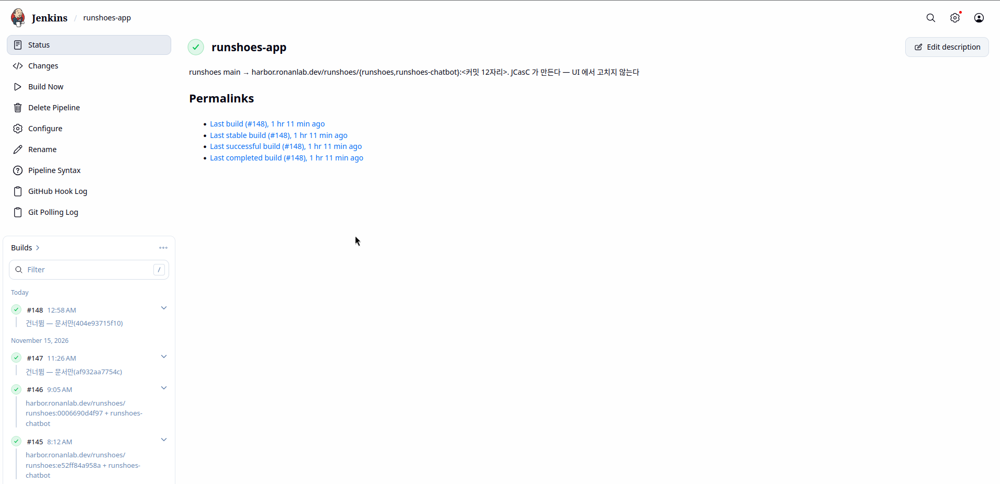
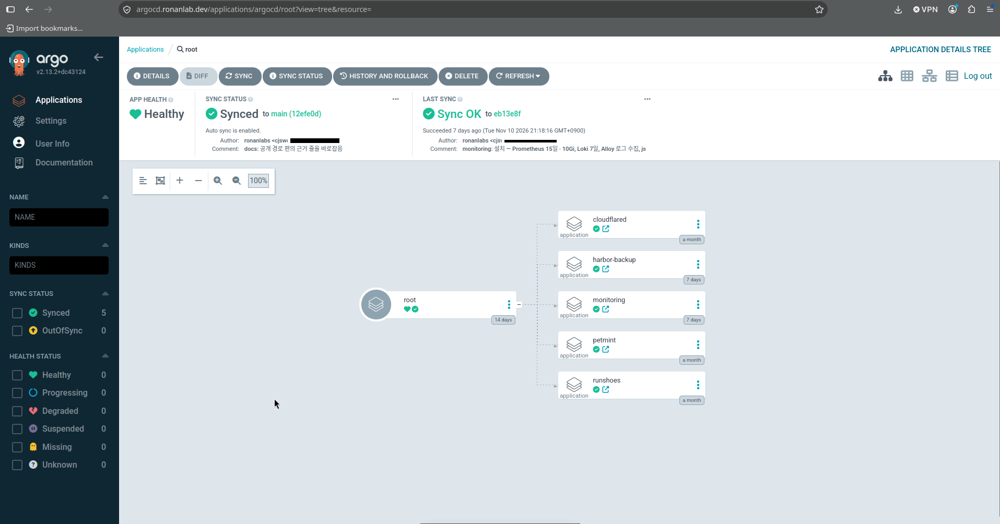
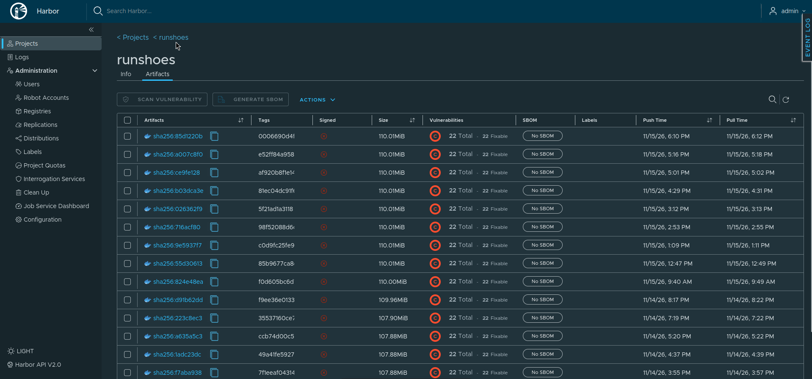

<!--
다루는 곳: bootstrap/root-app.yaml, apps/runshoes/app.yaml, apps/cloudflared/app.yaml, apps/harbor-backup/app.yaml, apps/petmint/kustomization.yaml, apps/runshoes/kustomization.yaml, platform/jenkins/values.yaml, platform/versions.yaml, platform/ingress-nginx/base/deploy.yaml, apps/runshoes/runbooks/
읽은 커밋: ddbaadf
-->
# 사람 손을 타지 않는 배포

> 이 글은 앱 저장소에 코드를 올리면 사람이 명령을 치지 않아도 클러스터까지 들어가는 배포 길을 다룹니다.

**앱 코드를 올리면 Jenkins가 이미지를 굽고, 사설 이미지 저장소 Harbor에 올리고, 이 저장소에 새 이미지 태그를 커밋합니다. ArgoCD가 그 커밋을 읽어 클러스터에 넣습니다. 사람이 하는 일은 코드를 올리는 것까지이고, 무엇이 어느 판으로 도는지는 언제나 저장소의 커밋으로 남습니다.**

## 상황

클러스터에는 펫퍼민트와 런슈즈 두 앱이 올라가고, 두 앱의 코드는 각자 다른 저장소에 있습니다. [code:apps/petmint/kustomization.yaml:3] [code:apps/runshoes/app.yaml:1] 처음에는 쿠버네티스에 넣는 일을 사람이 명령으로 하나씩 했습니다. 이 방식에는 약점이 셋 있었습니다. 누가 무엇을 바꿨는지 클러스터 어디에도 남지 않고, 잘못 넣었을 때 되돌릴 기준이 없으며, 누가 몰래 고쳐도 알아챌 길이 없습니다. [docs:history/build_log/04_argocd.md:118-126]

## 고른 것

배포는 네 단계로 이어집니다. 앱 저장소에 push가 생기면 GitHub가 웹훅(일이 생겼을 때 다른 서비스를 불러 알려 주는 장치)으로 Jenkins를 부릅니다. [code:platform/jenkins/values.yaml:100-101] Jenkins는 클러스터 안에 빌드 파드를 띄워 이미지를 굽고, 앱 커밋 해시 앞 12자리를 태그로 붙여 Harbor에 올립니다. [code:platform/jenkins/values.yaml:104] [code:platform/jenkins/values.yaml:147] 그다음 이 저장소에서 그 앱의 이미지 태그 한 줄을 새 태그로 바꿔 커밋합니다. [code:apps/petmint/kustomization.yaml:3] [code:apps/runshoes/kustomization.yaml:25-26] 마지막으로 ArgoCD(Git 저장소와 클러스터를 계속 견주어 저장소 쪽으로 맞추는 도구)가 그 커밋을 받아 파드를 새 이미지로 바꿉니다. 자동 Sync인 앱은 태그 커밋이 3분 안에 배포됩니다. [code:apps/runshoes/app.yaml:5]

ArgoCD 쪽은 App of Apps로 짰습니다. ArgoCD에서 「어느 폴더를 어디에 넣을지」를 적은 단위를 Application이라고 하는데, 사람이 손으로 넣는 것은 루트 Application 하나뿐입니다. 루트는 `apps` 아래 앱 폴더마다 있는 `app.yaml`을 읽어 앱 Application을 만들어 줍니다. 새 앱을 올릴 때는 폴더 하나를 더해 push하면 됩니다. [code:bootstrap/root-app.yaml:1-4]

앱 Application은 다섯이고, 그중 runshoes, petmint, monitoring, harbor-backup 넷이 자동 Sync입니다. cloudflared 하나만 사람이 Sync를 누릅니다. [docs:history/cluster_state_20261116.md:54-61] cloudflared는 바깥에서 클러스터로 들어오는 터널이라, 잘못된 커밋 하나로 터널이 깨지면 서비스만 멈추는 것이 아니라 고칠 때 쓰는 ArgoCD 화면과 상황을 볼 Grafana까지 함께 보이지 않게 됩니다. 그래서 커밋이 곧바로 반영되지 않게 하고, 사람이 Sync한 뒤 새 파드로 갈아타는 과정을 지켜봅니다. [code:apps/cloudflared/app.yaml:4-8] 터널은 → 「포트포워딩 없이 공개하기」에서 다룹니다.

이미지 태그는 하나도 빠짐없이 판을 고정했습니다. 클러스터에서 도는 파드 이미지 가운데 「가장 새것」을 뜻하는 `latest`는 하나도 없습니다. [docs:history/cluster_state_20261116.md:71] 앱 이미지는 커밋 해시 태그를 Kustomize(여러 매니페스트를 묶고 공통 값을 덧씌우는 도구)의 태그 칸 한 곳에 적고, Jenkins가 그 줄만 바꿉니다. [code:apps/petmint/kustomization.yaml:30-32] 들어오는 문인 ingress-nginx는 판 태그에 더해 digest(이미지 내용으로 계산한 지문)까지 고정했습니다. [code:platform/ingress-nginx/base/deploy.yaml:445] Helm 차트나 매니페스트 주소로 저장소 밖에서 넣은 것은 클러스터만 판을 알고 있었기 때문에, 다시 만들 때 같은 판을 깔 수 있도록 판 기록 파일에 옮겨 적었습니다. [code:platform/versions.yaml:1-6] [docs:history/human_answers_20261116.md:19]

## 까닭

Git을 기준으로 삼으면 바뀐 내용이 모두 커밋으로 남고, 되돌리기는 앞 커밋으로 돌아가는 일이 됩니다. [docs:history/build_log/04_argocd.md:118-130] 이미지만 되돌릴 때는 태그 커밋 하나를 거꾸로 적용하는 커밋(revert)을 올리면 자동 Sync가 옛 이미지로 바꿉니다. [code:apps/runshoes/README.md:64]

태그를 고정한 것도 같은 생각입니다. `latest`를 쓰면 파드를 하나씩 새것으로 바꾸는 동안 어느 파드가 무엇을 도는지 알 수 없습니다. [code:apps/petmint/kustomization.yaml:32] 커밋 해시를 태그로 쓰면 태그만 보고 어느 커밋이 도는지 알 수 있습니다. [code:apps/runshoes/kustomization.yaml:26]

Jenkins는 빌드 파드를 띄우고, 권한을 주고, 이미지를 밀어 넣는 과정 전체를 손으로 다루려고 직접 세웠습니다. 채용 공고에서 Jenkins가 여전히 많이 보인다는 것도 까닭이었습니다. [docs:history/build_log/06_jenkins.md:118-122] 빌드 파드는 특권 없이 이미지를 굽게 짰습니다. 특권 컨테이너는 뚫리면 노드 전체가 뚫리기 때문입니다. [docs:history/build_log/06_jenkins.md:124-137] Harbor는 앱 코드가 든 이미지를 공개 저장소에 올릴 수 없고, 학교 Harbor는 학교 안 망에서만 열려 서버에서 닿지 않아 직접 세웠습니다. 프로젝트별 권한과 취약점 검사가 기본으로 들어 있는 것이 Harbor를 고른 까닭입니다. [docs:history/build_log/05_harbor.md:170-174]

앱 저장소와 이 매니페스트 저장소를 나눈 것은 배포 고리 때문입니다. 한 저장소에 두면 Jenkins가 태그를 바꿔 올린 push가 다시 빌드를 불러 끝없이 돕니다. [docs:history/build_log/06_jenkins.md:195] 같은 까닭으로 Jenkins는 이 저장소를 감시하지 않는 일반 복제 명령으로 받습니다. [docs:history/build_log/07_project_deploy.md:222-228] 태그 줄을 바꾼 뒤에는 정말 새 태그가 되었는지 다시 셉니다. 줄을 바꾸는 명령은 아무것도 못 바꿔도 성공으로 끝나, 배포만 조용히 빠질 수 있기 때문입니다. [docs:history/build_log/07_project_deploy.md:212-220]

모든 것이 이 길을 타지는 않습니다. 인증서 관리 도구(cert-manager), 로드밸런서(MetalLB), Harbor, Jenkins, ingress-nginx 같은 기반은 ArgoCD 밖에 있고 사람이 손으로 넣습니다. 기록된 까닭은 이것들이 ArgoCD보다 먼저 깔린 기반이라는 것입니다. [code:bootstrap/root-app.yaml:13] 그중 cert-manager, MetalLB, Harbor, Jenkins는 Helm 차트로 넣었고, 차트 판과 설정 값 파일은 저장소에 둡니다. [docs:history/human_answers_20261117.md:14] [code:platform/versions.yaml:32-53]

## 치른 값

- 자동 Sync인 앱은 push가 곧 배포입니다. 데이터베이스 구조를 바꾸는 배포는 자동 Sync를 잠시 끄고 사람이 단계마다 확인하며 넣습니다. [code:apps/runshoes/app.yaml:9]
- 저장소에서 지운 리소스를 클러스터에서도 지우는 기능(prune)을 꺼 두었습니다. 저장소에서 지운 것이 클러스터에서 바로 사라지지 않게 하려는 것이라, 클러스터에 남은 것은 사람이 따로 지워야 합니다. [code:bootstrap/root-app.yaml:11] [code:apps/runshoes/app.yaml:8] [docs:history/build_log/07_project_deploy.md:261]
- Harbor는 데이터베이스만 백업하고 이미지 층은 백업하지 않습니다. 층이 사라진 태그는 내려받을 수 없고, 앱 이미지는 앱 저장소의 커밋에서 다시 빌드할 수 있다는 것을 전제로 합니다. [code:apps/harbor-backup/README.md:15-16]
- ArgoCD 밖의 기반을 사람이 손으로 넣는 것과 Jenkins가 한 노드에 묶인 것은 여러 결정에 걸려 → 「알려진 한계」에 모았습니다

## 조건

아래는 고른 것이 아니라 바탕이 그러해서 따라오는 것입니다.

- 태그 커밋을 되돌려도 데이터베이스 마이그레이션은 되돌아가지 않습니다. [code:apps/petmint/README.md:27]

## 막혔을 때: 자동 Sync가 켜진 채 push가 먼저 나간 일

자동 Sync는 편하지만, 데이터베이스 구조를 바꾸는 배포에서는 위험이 됩니다. 런슈즈는 새 이미지의 파드가 뜰 때 구조 변경을 적용하므로, 덤프(백업)와 복원 확인보다 태그 커밋이 먼저 들어가면 백업 없이 구조가 바뀝니다. [code:apps/runshoes/app.yaml:9] [code:apps/runshoes/runbooks/v24-chatbot-miss-note.md:63]

이 순서를 지키려면 두 가지가 필요했습니다. 하나는 자동 Sync를 잠시 끈 것이 도로 켜지지 않는 것입니다. 루트가 앱의 Sync 설정까지 저장소대로 맞추면, Jenkins의 태그 커밋 하나에 루트가 다시 Sync하면서 꺼 둔 자동 Sync를 도로 켭니다. 그래서 루트는 앱의 Sync 설정을 덮지 않게 했고, 자동 Sync의 실제 스위치는 클러스터에서 Application을 직접 고치는 명령이 되었습니다. [code:bootstrap/root-app.yaml:8-10]

다른 하나는 사람이 순서를 지키는 것인데, 여기서 실제로 어긋난 일이 있었습니다. 런슈즈의 한 구조 변경 배포에서 자동 Sync가 켜진 채 앱 push가 먼저 나갔습니다. Jenkins 빌드가 끝나 태그 커밋이 생기기 전에 자동 Sync를 꺼서 태그 커밋이 자동으로 들어가지 않았고, 덤프와 복원 확인을 거친 뒤 사람이 Sync했습니다. [code:apps/runshoes/runbooks/v22-v23-review-hide-miss-status.md:150-155] 빌드가 더 빨랐다면 덤프 없이 구조가 바뀌었을 것입니다. [code:apps/runshoes/runbooks/v22-v23-review-hide-miss-status.md:158]

그 뒤로 절차 첫머리에 「자동 Sync를 끄고 끈 것을 확인하는 일은 반드시 push 전에」를 다시 적고, 확인 명령의 출력을 붙여 보인 뒤에야 push하게 했습니다. [code:apps/runshoes/runbooks/v24-chatbot-miss-note.md:40-50] [code:apps/runshoes/runbooks/v24-chatbot-miss-note.md:63]
