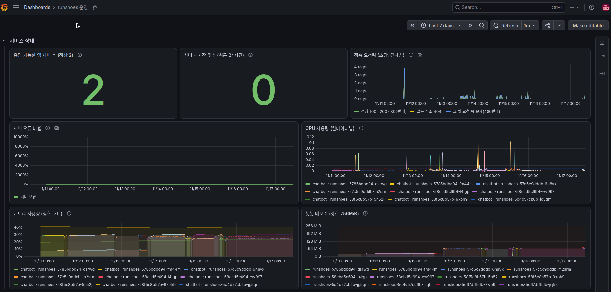

<!--
다루는 곳: apps/monitoring/
읽은 커밋: 02c240c
-->
# 모니터링은 차트 대신 매니페스트로

> 이 글은 모니터링을 흔히 쓰는 Helm 차트 대신 손으로 쓴 매니페스트로 꾸린 결정과, 대화 내용이 모니터링으로 새지 않게 한 결정을 다룹니다.

**지표(Prometheus), 로그(Alloy와 Loki), 대시보드(Grafana)를 차트 없이 손으로 쓴 매니페스트로 저장소에 두고 ArgoCD가 클러스터에 넣게 했습니다. 대시보드가 데이터베이스를 읽을 때는 복제본을 읽고, 질문과 답 본문은 읽을 수 없는 계정만 씁니다.**

## 상황

모니터링은 세 가지로 이루어집니다. 시간에 따른 숫자(CPU, 메모리, 요청 수, GPU 사용률)인 지표는 Prometheus가 모으고, 서버가 남기는 글 기록인 로그는 Alloy가 모아 Loki에 넣으며, 사람이 보는 화면은 Grafana가 그립니다. [code:apps/monitoring/README.md:3]

쿠버네티스에서 이 묶음을 넣는 흔한 길은 kube-prometheus-stack이라는 Helm 차트(여러 매니페스트를 묶어 값만 넣으면 설치되게 만든 꾸러미)입니다. 처음 계획도 이 차트였습니다. [docs:history/build_log/09_monitoring.md:31] 그런데 `helm install`로 넣으면 설정이 클러스터 안에만 남아, 다시 만들 때 무엇을 어떻게 했는지 알 수 없게 됩니다. [docs:history/build_log/09_monitoring.md:31]

## 고른 것

차트를 쓰지 않고 매니페스트를 직접 써서 `apps/monitoring/`에 두었습니다. ArgoCD(저장소의 내용대로 클러스터를 맞추는 도구)가 이 폴더를 자동으로 클러스터에 넣습니다. [code:apps/monitoring/app.yaml:20-27] Prometheus는 Operator(설정을 쿠버네티스 객체로 받아 대신 관리해 주는 프로그램) 없이 설정 파일 하나로 지표를 긁고, Grafana의 데이터 연결과 대시보드도 저장소의 파일로 넣습니다. [docs:history/build_log/09_monitoring.md:32] 대시보드는 저장소의 생성 스크립트를 고쳐 JSON을 다시 만들고, push하면 반영됩니다. [code:apps/monitoring/README.md:4]

## 까닭

까닭은 두 가지가 기록에 있습니다. 첫째, 모니터링을 들일 때 MetalLB, cert-manager, ingress, Jenkins 설정은 이미 모두 저장소에 남겨 두었는데, 모니터링만 클러스터 안에 두면 그곳만 구멍이 된다고 보았습니다. [docs:history/build_log/09_monitoring.md:31] 둘째, 그때 지표 출처가 넷뿐이어서 Operator와 CRD(쿠버네티스에 새 종류의 객체를 더하는 정의)가 덜어 주는 일보다 늘리는 구성이 더 많았습니다. [docs:history/build_log/09_monitoring.md:33]

차트를 아예 쓰지 않은 것은 아닙니다. cert-manager, MetalLB, Harbor, Jenkins 자체는 Helm 차트로 넣었고, 차트에 넣은 설정 값 파일과 차트 판을 저장소에 둡니다. [docs:history/human_answers_20261117.md:14] [code:platform/versions.yaml:32-53] 차트 없이 매니페스트로 쓴 것은 모니터링과 앱입니다. [docs:history/human_answers_20261117.md:14] 어느 쪽이든 「설정이 저장소에 남는다」는 기준은 같고, 모니터링에서는 그 기준을 지키는 데 차트가 오히려 짐이 된다고 판단한 것입니다.

## 대화 내용은 모니터링에 넣지 않는다

모니터링을 꾸리면서 또 하나 정한 것은 사용자의 대화가 모니터링으로 새지 않게 하는 것입니다.

질문 수, 응답 시간, 평가 같은 상담 지표는 앱 데이터베이스의 대화 기록 표에만 있습니다. 그런데 그 표에는 질문과 답 본문도 함께 들어 있습니다. [docs:history/build_log/09_monitoring.md:64] 그래서 Grafana가 데이터베이스를 읽을 때 세 가지를 지키게 했습니다. 운영 데이터베이스(원본)가 아니라 복제본을 읽어 대시보드 조회가 운영 쓰기에 부하를 주지 않게 했습니다. 읽기 계정은 칸 단위로 권한을 받아 분류, 시간, 상태 같은 칸만 읽고, 질문, 답, 코멘트, 고객, 상담원 칸은 읽을 수 없습니다. Grafana가 여는 연결 수에도 상한을 두었습니다. [code:apps/monitoring/grafana/datasource.yaml:26-38] 런슈즈 데이터베이스도 같은 방식으로 복제본을 읽고, 챗봇 질문과 답 원문 칸에는 권한이 없습니다. [code:apps/monitoring/grafana/datasource.yaml:43-53] 권한이 정말 막혔는지는 그 칸을 읽어 거부 오류가 나는 것으로 확인했습니다. [docs:history/build_log/09_monitoring.md:82-83]

로그도 같은 생각입니다. 대화 기록은 이미 데이터베이스에 있는데 로그에도 들어가면, 같은 내용이 권한이 다른 곳에 하나 더 생깁니다. 확인해 보니 런슈즈 챗봇이 질문 원문을 로그로 찍고 있었습니다. [docs:history/build_log/09_monitoring.md:90] 그래서 Loki에는 서버 로그만 넣기로 하고, 로그 수집기가 그 줄을 버리게 했습니다. 빌드 파드가 내는 빌드 출력도 넣지 않습니다. [code:apps/monitoring/alloy/alloy.yaml:1-4] [code:apps/monitoring/alloy/alloy.yaml:94-103]

## 치른 값

- 판을 올리는 일이 손일입니다. 이미지 태그를 하나씩 바꾸고 호환을 직접 확인합니다. 차트가 주는 기본 대시보드와 경보 규칙도 없습니다. [docs:history/build_log/09_monitoring.md:34]
- Grafana는 저장 공간 없이 돕니다. 화면에서 고친 대시보드는 파드를 다시 만들면 사라지므로, 대시보드는 저장소의 파일로만 바꿉니다. [code:apps/monitoring/grafana/deployment.yaml:2]
- 알림(Alertmanager)이 아직 없습니다. 무슨 일이 생겼는지는 사람이 대시보드를 열어야 압니다. [code:apps/monitoring/README.md:3]
- 데이터베이스에 새 칸이 생기면 읽기 계정의 권한을 손으로 더해야 합니다. 복제본이 멈추거나 늦으면 상담 패널도 멈추거나 늦습니다. [docs:history/build_log/09_monitoring.md:70]
- 로그 거르기는 글자 일치입니다. 앱이 로그 꼴을 바꾸거나 다른 앱이 새로 원문을 찍으면, 수집기 설정을 고치기 전까지 걸러지지 않고 들어갑니다. [docs:history/build_log/09_monitoring.md:109-110]
- 호스트의 검색 서비스와 model-service가 살아 있는지는 보지 못합니다. [docs:history/build_log/09_monitoring.md:212]

## 막혔을 때

처음에는 Grafana를 클러스터 밖으로 열지 않고 사람 컴퓨터로 포트를 이어 붙여(port-forward) 보았습니다. 대시보드는 패널마다 조회를 동시에 보내는데, 이 연결이 그때 끊겼습니다. 그래서 다른 운영 도구와 같은 모양으로 Ingress(바깥 요청을 주소에 따라 서비스로 나눠 주는 규칙)를 만들고, 바깥에서는 Cloudflare 터널과 사람 인증 관문 뒤에서 열게 했습니다. [code:apps/monitoring/ingress.yaml:1-7] [docs:history/build_log/09_monitoring.md:128-130]

그 뒤에는 Grafana가 대시보드 화면을 열 때 메모리 상한을 넘어 강제로 종료되고, 바깥에서는 오류 응답으로 보였습니다. 처음 정한 메모리 상한이 기동만으로 거의 찰 만큼 작았던 것이 원인이었습니다. 메모리 요청과 상한을 올리고 상태 검사의 기다림 시간을 늘려 풀었습니다. [docs:history/build_log/09_monitoring.md:201] [code:apps/monitoring/grafana/deployment.yaml:59-69]
